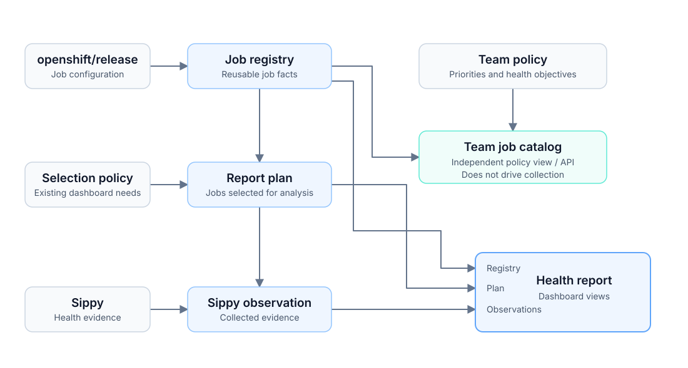

# HyperShift CI Health

A dashboard for the health of HyperShift's required presubmit jobs, release
payload blockers, and Component Readiness blockers. Its data pipeline produces
five immutable, versioned artifacts: registry facts, an independent team job
policy catalog, a report plan, Sippy observations, and an evaluated health
report. The HTTP server performs no live collection.

## Quick start

Requires Go 1.25+ and a checkout of
[`openshift/release`](https://github.com/openshift/release).

Generate the artifacts and start the server:

```bash
make generate-artifacts RELEASE_DIR=/path/to/openshift-release
make dev
```

The server reads the generated files from its current directory. File paths can
be overridden with command-line flags.

## Data pipeline



The registry is the reusable job inventory. The report plan selects the jobs to
analyze. Sippy is authoritative  job
health evidence and Component Readiness participation. The health report combines those inputs for presentation.

## Job Policy

Job policy separates team priorities from registry facts. It combines job
dimensions with explicit team assumptions to produce a deterministic importance
ranking and structured health objectives, giving API clients a consistent basis
for prioritization and future health analysis.

The standalone `/policy` view exposes these decisions and their explanations.
Policy output does not yet drive collection or health evaluation, so teams can
refine it without changing the existing dashboard's collection set. See the
[team policy documentation](jobpolicy/README.md) for configuration and usage.

## Public API

The job registry and team policy APIs provide a supported contract for external
clients. See the running server's [API documentation](/api/docs) for endpoints
and schemas.

Dashboard-specific APIs are private and carry no compatibility guarantee. This
boundary lets the UI evolve while external integrations rely on the public
contract.

## Deployment

Deployment targets OpenShift and requires `oc` access to the target cluster:

```bash
make setup
make deploy
```

## UI development

The dashboard is a no-build Preact application using HTM templates and native
browser modules. Preact, HTM, and Fuse.js are pinned and embedded in the Go
binary; production does not load code from a CDN and does not require Node.js.

Generate the data artifacts once, then run the development server:

```bash
make dev
```

Development mode reads files under `assets/` directly and disables browser
caching, so editing a component or stylesheet only requires a page refresh.
`make test` runs the Go tests and, when Node.js is already available, syntax
checks the application modules. Node is optional and is not part of the build.

Each dashboard perspective has a shareable path: `/presubmits`, `/payload`,
`/component-readiness`, `/registry`, and `/policy`. View state is encoded in query
parameters. The URL is the sole persisted source of UI state;
navigation works with browser history and the application does not use local
storage. The root path redirects to `/presubmits`.

Browser behavior is covered by an optional Playwright suite. Install its pinned
test dependency and Chromium once, then run it against the production-embedded
UI and the generated local artifacts:

```bash
make install-e2e
make test-e2e
```

Playwright and Node.js are development-only dependencies. Test traces are
retained under `/tmp/ci-health-playwright-results` when a browser test fails.

UI responsibilities are split between:

- `assets/web/app.js` — data loading, application state, and URL synchronization;
- `assets/web/ui.js` — pure display and grouping helpers;
- `assets/web/components/` — controls, health views, charts, and registry views; and
- `assets/web/styles.css` — the dashboard visual system.

The UI consumes the private per-window dashboard projection and the public job
registry and team policy APIs. It does not reach into report-plan or observation artifacts.
